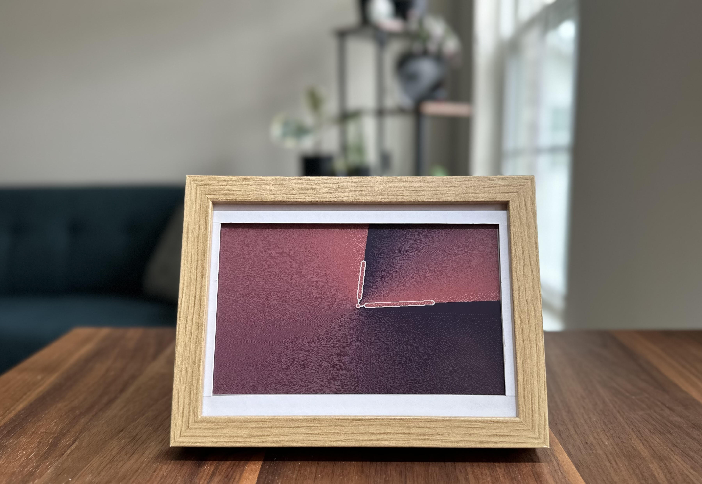
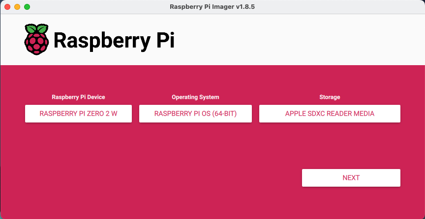
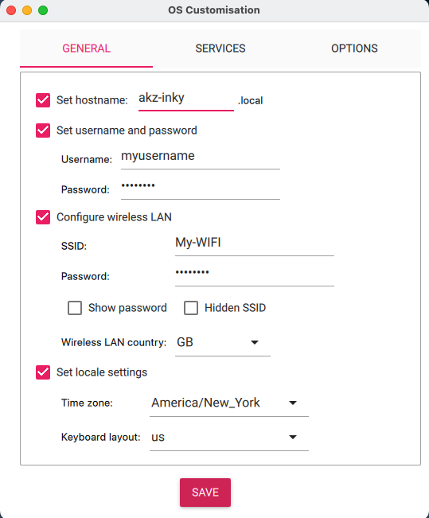
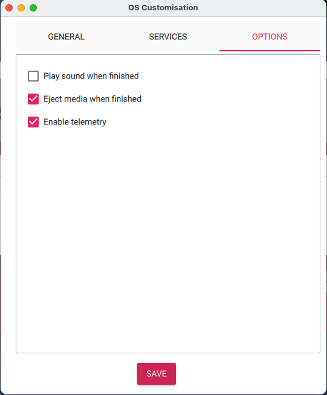
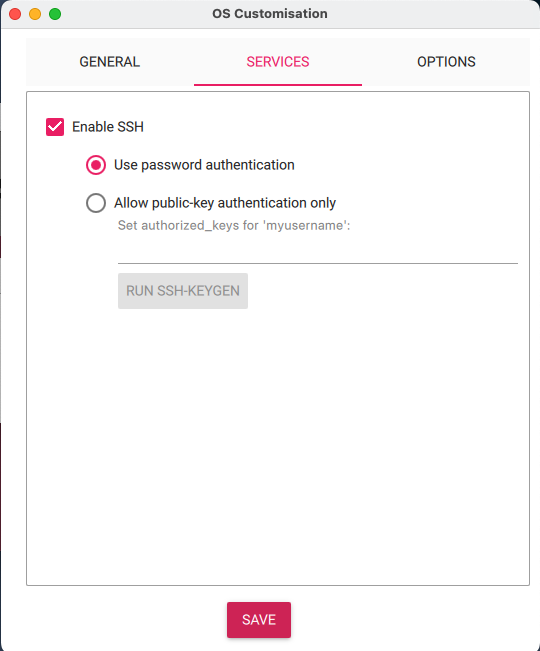

# InkyPi



## О проекте

InkyPi — это открытый проект для создания настраиваемого E-Ink дисплея на базе Raspberry Pi. Проект разработан для простоты и гибкости, позволяя легко отображать нужный контент через удобный веб-интерфейс для настройки и конфигурации.

**InkyPi решает проблему** создания информационного дисплея с бумагоподобной эстетикой, который не отвлекает внимание и потребляет минимум энергии, идеально подходя для домашнего или офисного использования.

## ✨ Особенности

- **Естественная эстетика**: четкое, минималистичное изображение без бликов и подсветки
- **Веб-интерфейс**: обновление и настройка дисплея с любого устройства в сети
- **Минимум отвлечений**: нет светодиодов, звуков или уведомлений, только нужный контент
- **Простая установка и настройка**: идеально подходит для начинающих и опытных пользователей
- **Открытый исходный код**: возможность модификации, кастомизации и создания собственных плагинов
- **Плейлисты по расписанию**: настройка отображения разных плагинов в определенное время
- **Режим разработки**: разработка без физического оборудования на macOS, Linux и Windows

## 🚀 Быстрый старт

### Требования к оборудованию

- **Raspberry Pi** (4 | 3 | Zero 2 W)
  - Рекомендуется использовать с предустановленным 40-пиновым разъемом
- **MicroSD карта** (минимум 8 GB)
- **E-Ink дисплей**:
  - **Inky Impression** от Pimoroni (4", 5.7", 7.3", 13.3")
  - **Inky wHAT** от Pimoroni (4.2")
  - **Waveshare e-Paper** дисплеи (поддерживаются модели с драйверами из официального репозитория)

### Установка

1. **Клонируйте репозиторий:**

2. **Запустите скрипт установки:**

   Для дисплеев Inky:
   ```bash
   sudo bash install/install.sh
   ```

   Для дисплеев Waveshare (укажите модель, например `epd7in3f`):
   ```bash
   sudo bash install/install.sh -W epd7in3f
   ```

3. **Перезагрузите Raspberry Pi:**
   После завершения установки перезагрузите устройство. После перезагрузки дисплей покажет экран приветствия InkyPi.

**Примечания:**
- Скрипт установки требует права sudo для установки и запуска сервиса
- Рекомендуется начинать с чистой установки Raspberry Pi OS
- Скрипт автоматически включит необходимые интерфейсы SPI и I2C

### Первый запуск

После перезагрузки Raspberry Pi:

1. Откройте веб-браузер на любом устройстве в вашей сети
2. Перейдите по адресу `http://<hostname>.local` или `http://<IP-адрес>`
3. Начните настраивать плагины и создавать плейлисты через веб-интерфейс

## 📁 Структура проекта

```
InkyPi/
├── src/                    # Исходный код приложения
│   ├── blueprints/         # Flask blueprints (маршруты)
│   ├── config/             # Конфигурационные файлы
│   ├── display/            # Модули управления дисплеями
│   ├── plugins/            # Плагины (см. список ниже)
│   ├── static/             # Статические файлы (шрифты, иконки, стили)
│   ├── templates/          # HTML шаблоны
│   ├── utils/              # Вспомогательные утилиты
│   ├── config.py           # Класс конфигурации
│   ├── inkypi.py           # Главный файл приложения
│   └── model.py            # Модели данных
├── install/                # Скрипты установки и конфигурации
│   ├── install.sh          # Скрипт установки
│   ├── update.sh           # Скрипт обновления
│   ├── uninstall.sh        # Скрипт удаления
│   └── requirements.txt    # Python зависимости
├── scripts/                # Вспомогательные скрипты
└── images/                 # Изображения для документации
```

## 🛠 Использование

### Веб-интерфейс

После установки InkyPi запускается как системный сервис и доступен через веб-интерфейс. Основные возможности:

- **Плагины**: Просмотр и настройка доступных плагинов
- **Плейлисты**: Создание и управление плейлистами с расписанием
- **Настройки**: Конфигурация устройства, часового пояса и других параметров
- **Отображение**: Ручное обновление дисплея выбранным плагином

### Доступные плагины

- **Загрузка изображений**: Загружайте и отображайте любые изображения из браузера
- **Ежедневная газета/Комиксы**: Показывайте ежедневные комиксы и первые страницы крупных газет со всего мира
- **Часы**: Настраиваемые циферблаты для отображения времени
- **AI Изображения/Текст**: Генерация изображений и динамического текста из промптов с использованием моделей OpenAI
- **Погода**: Отображение текущих погодных условий и прогнозов на несколько дней с настраиваемым макетом
- **Календарь**: Визуализация календаря из Google, Outlook или Apple Calendar с настраиваемыми макетами
- **RSS**: Отображение новостных лент
- **GitHub**: Статистика репозиториев, спонсоров и контрибьюторов
- **Список дел**: Управление задачами
- **Обратный отсчет**: Отсчет до важных событий
- **Прогресс года**: Визуализация прогресса текущего года
- **APOD**: Астрономическая картинка дня от NASA
- **Unsplash**: Случайные фотографии высокого качества
- **Скриншот**: Захват веб-страниц
- **Альбом изображений**: Отображение альбомов из Immich или локальной папки

### Настройка API ключей

Некоторые плагины требуют API ключи для работы. Создайте файл `.env` в корне проекта и добавьте необходимые ключи:

```bash
OPEN_AI_SECRET=your-openai-key
OPEN_WEATHER_MAP_SECRET=your-weather-key
NASA_SECRET=your-nasa-key
UNSPLASH_ACCESS_KEY=your-unsplash-key
GITHUB_SECRET=your-github-token
IMMICH_KEY=your-immich-key
```

**Где получить ключи:**
- **OpenAI**: [platform.openai.com](https://platform.openai.com/docs/overview) — для AI Image и AI Text плагинов
- **OpenWeatherMap**: [openweathermap.org](https://home.openweathermap.org/users/sign_in) — для Weather плагина (требуется подписка на One Call API 3.0, бесплатно до 1000 запросов в день)
- **NASA**: [api.nasa.gov](https://api.nasa.gov/) — для APOD плагина (бесплатно до 1000 запросов в час)
- **Unsplash**: [unsplash.com/developers](https://unsplash.com/developers) — для Unsplash плагина
- **GitHub**: [github.com/settings/tokens](https://github.com/settings/tokens) — для GitHub плагина (Personal access token с правом `read:user`)

### Обновление

Для обновления InkyPi до последней версии:

```bash
cd InkyPi
git pull
sudo bash install/update.sh
```

### Удаление

Для удаления InkyPi:

```bash
sudo bash install/uninstall.sh
```

## 🧪 Технологии

- **Python 3** — основной язык программирования
- **Flask** — веб-фреймворк
- **Pillow** — обработка изображений
- **Jinja2** — шаблонизация HTML
- **Waitress** — WSGI сервер
- **Chrome Headless Shell** — рендеринг HTML в изображения
- **Inky Library** — работа с дисплеями Pimoroni
- **Waveshare EPD** — поддержка дисплеев Waveshare

## 🔧 Разработка

### Режим разработки без оборудования

InkyPi поддерживает режим разработки, который позволяет разрабатывать плагины и тестировать интерфейс без физического оборудования:

```bash
# 1. Клонируйте репозиторий
git clone https://github.com/QuestGuideRF/inkypi.git
cd inkypi

# 2. Создайте виртуальное окружение
python3 -m venv venv
source venv/bin/activate  # Windows: venv\Scripts\activate

# 3. Установите зависимости и запустите
pip install -r install/requirements-dev.txt
bash install/update_vendors.sh
python src/inkypi.py --dev
```

Откройте http://localhost:8080 в браузере. Результаты рендеринга сохраняются в `mock_display_output/latest.png`.

**Что можно делать в режиме разработки:**
- Разрабатывать новые плагины без Raspberry Pi и физических дисплеев
- Тестировать изменения веб-интерфейса
- Отлаживать проблемы с полными сообщениями об ошибках в терминале
- Проверять рендеринг в `mock_display_output/latest.png`
- Разрабатывать на macOS, Linux и Windows

### Создание плагинов

Для создания собственного плагина:

1. Создайте директорию в `src/plugins/` с именем вашего плагина
2. Создайте Python файл с классом, наследующимся от `BasePlugin`
3. Реализуйте метод `generate_image(settings, device_config)`
4. Создайте `plugin-info.json` с метаданными плагина
5. Добавьте `icon.png` и опционально `settings.html`

Подробная документация по созданию плагинов доступна в исходном коде базового плагина (`src/plugins/base_plugin/base_plugin.py`).

## 📸 Изображения установки

### Настройка Raspberry Pi OS



При использовании Raspberry Pi Imager:

1. Выберите модель Raspberry Pi и операционную систему
2. Нажмите "Next" и выберите "Edit Settings"

**Общие настройки:**
- Установите hostname (для доступа по сети)
- Настройте имя пользователя и пароль
- Настройте беспроводную сеть
- Установите часовой пояс





**Сервисы:**
- Включите SSH с аутентификацией по паролю

## 🐛 Решение проблем

### Сервис не запускается

Проверьте статус сервиса:
```bash
sudo systemctl status inkypi.service
```

Просмотр логов:
```bash
journalctl -u inkypi -n 100
```

Перезапуск сервиса:
```bash
sudo systemctl restart inkypi.service
```

### Ручной запуск для диагностики

```bash
sudo /usr/local/bin/inkypi -d
```

### Неправильное время

Если отображаемое время неверно, проверьте настройки часового пояса на странице Settings в веб-интерфейсе.

### Ошибки API

Убедитесь, что все необходимые API ключи правильно настроены в файле `.env` в корне проекта.

### Проблемы с Waveshare дисплеями

- Убедитесь, что указана правильная модель дисплея при установке
- Проверьте наличие необходимых модулей: `gpiozero`, `lgpio`, `RPi.GPIO`
- Проверьте конфигурацию SPI: `ls /dev/sp*` должен показывать `spidev0.0` и `spidev0.1`

**Важно:** Дисплеи на базе контроллера IT8951 не поддерживаются. Дисплеи меньше 4 дюймов не рекомендуются из-за ограниченного разрешения.

## 📝 Поддержка Waveshare дисплеев

Waveshare предлагает ряд e-Paper дисплеев, похожих на экраны Inky от Pimoroni, но с немного другими требованиями. В то время как дисплеи Inky автоматически настраиваются через библиотеку inky Python, дисплеи Waveshare требуют драйверов для конкретной модели из их [Python EPD библиотеки](https://github.com/waveshareteam/e-Paper/tree/master/RaspberryPi_JetsonNano/python/lib/waveshare_epd).

Проект протестирован с несколькими моделями Waveshare. Если модель вашего дисплея имеет соответствующий драйвер по ссылке выше, он, вероятно, совместим. При запуске скрипта установки используйте опцию `-W` для указания модели дисплея (без расширения .py). Скрипт автоматически загрузит и установит правильный драйвер.

## Источники изображений

| Плагин | Настройка |
| --- | --- |
| Изображение по URL | Укажите URL файла. Плагин загружает изображение и показывает его на дисплее. |
| Альбом Immich | Создайте альбом и ключ с правами `asset.read`, `asset.download`, `album.read`. Сохраните ключ в `.env` как `IMMICH_KEY`. |
| Unsplash | Создайте приложение в [Unsplash](https://unsplash.com/oauth/applications) и сохраните его Access Key в `.env` как `UNSPLASH_ACCESS_KEY`. |

Иконка плагина загрузки по URL: [UI icons created by Prashanth Rapolu 15 - Flaticon](https://www.flaticon.com/free-icons/ui).

Подпись относится к текущей версии проекта.

---

Автор: legenda  
Telegram: [@LEGENDA_SD](https://t.me/LEGENDA_SD)
